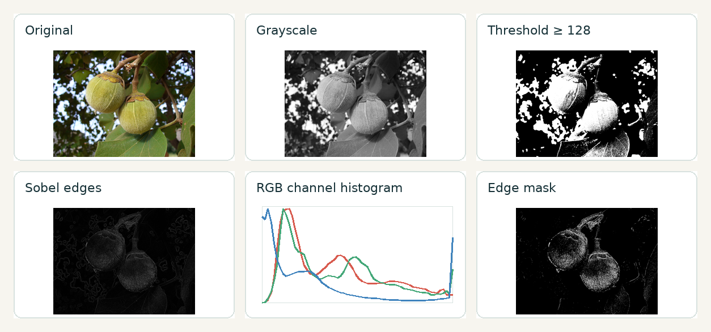
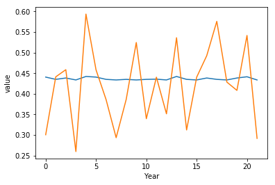
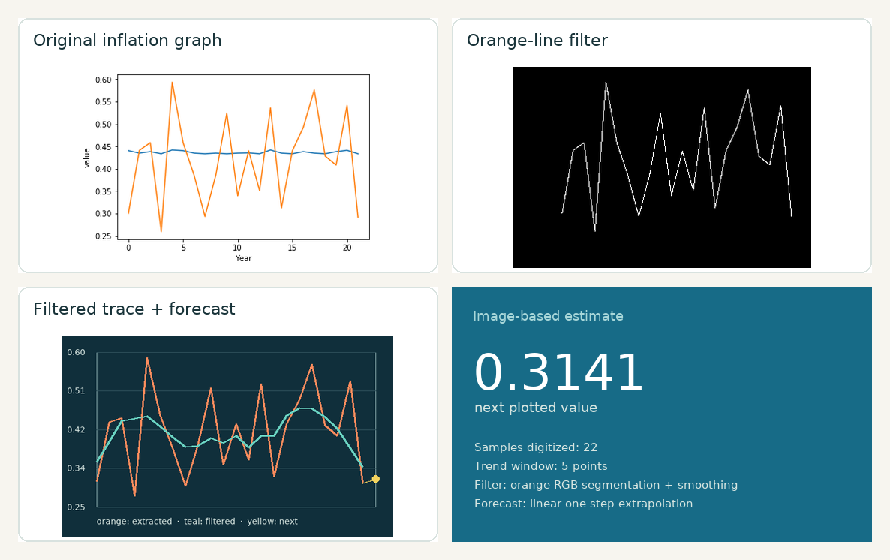

<h1 align="center">Inflation Prediction Project</h1>

<p align="center">
  A small, visual machine-learning laboratory: a Flask prediction app, saved regression experiments, image-processing utilities, and an optional temporal CNN.
</p>

<p align="center">
  
  
  
  
</p>

## What is inside

Inflation Lab started as a 2017 classroom project around inflation-rate regression. It now has a cleaner application boundary and a broader experiment surface:

| Area | What it does |
| --- | --- |
| **Web app** | Collects ten economic indicators and runs the preserved K-nearest-neighbors estimator. |
| **Model evaluation** | Shows the saved predicted-vs-actual series and mean squared error. |
| **Computer vision** | Generates grayscale, threshold, Sobel-edge, histogram, and edge-mask views from an image. |
| **Graph-image prediction** | Filters the inflation graph, digitizes the orange curve, and extrapolates its next plotted value. |
| **Temporal CNN** | Trains an optional 1D convolutional network over chronological economic windows. |

## Visual tour

The repository includes the original model plots plus a reproducible computer-vision inspection sheet generated from a real public-domain photograph.

<p align="center">
  
</p>

<p align="center"><em>Computer-vision preprocessing experiment: original → grayscale → threshold → Sobel edges.</em></p>

<p align="center">
  
  
</p>

<p align="center"><em>Historical KNN comparison and cross-validation artifacts.</em></p>

<p align="center">
  
</p>

<p align="center"><em>Graph-image experiment: filter the orange inflation curve, smooth its pixels, and estimate the next plotted value.</em></p>

## Quick start

The web application expects Python 3.9+ and the serialized model files in the project root.

```bash
python -m venv .venv
source .venv/bin/activate       # Windows: .venv\\Scripts\\activate
pip install -r requirements.txt
python app.py
```

Open <http://127.0.0.1:5000>. Set `FLASK_DEBUG=1` only during local development. For deployment, set a strong random `SECRET_KEY` in the environment.

With Flask 2.2+, the equivalent command is:

```bash
flask --app app:app run
```

## Experiments

### Computer vision

The dependency-light image experiment is in [`experiments/computer_vision.py`](experiments/computer_vision.py). It uses Pillow and NumPy to create a six-panel inspection sheet:

1. original RGB image;
2. luminance/grayscale conversion;
3. configurable binary threshold;
4. normalized Sobel gradient magnitude;
5. RGB channel histograms; and
6. a high-contrast edge mask.

Run it from the project root:

```bash
python -m experiments.computer_vision \
  --input static/images/cv-fruit-public-domain.jpg \
  --output docs/images/computer-vision-report.png
```

Try a different segmentation threshold:

```bash
python -m experiments.computer_vision \
  --input static/images/cv-fruit-public-domain.jpg \
  --output /tmp/vision-threshold-180.png \
  --threshold 180
```

### 1D CNN over economic time-series data

[`experiments/time_series_cnn.py`](experiments/time_series_cnn.py) treats a sequence of consecutive economic observations as a one-dimensional signal. Causal `Conv1D` layers learn local temporal patterns and a regression head predicts the next target value. The train/validation split is chronological and training uses `shuffle=False`.

TensorFlow is optional and is not imported by the Flask server:

```bash
pip install -r requirements-cnn.txt
python -m experiments.time_series_cnn \
  --data /path/to/pro.csv \
  --time-column Year \
  --target INFLATION \
  --window-size 5 \
  --output-dir artifacts/time-series-cnn
```

The run writes:

- `time_series_cnn.keras` — trained temporal CNN;
- `predictions.csv` — chronological validation predictions; and
- `metrics.json` — MAE, RMSE, window size, and sample counts.

The original `pro.csv` is not included in this checkout, so the CNN command needs a local copy of that dataset or an equivalent numeric CSV.

More detail is available in [`experiments/README.md`](experiments/README.md).

### Filter the inflation graph and predict

[`experiments/graph_image_predictor.py`](experiments/graph_image_predictor.py) uses the original KNN graph image as input. It applies an RGB color filter to isolate the orange inflation curve, interpolates missing pixels, smooths the extracted trace, maps pixels to the chart’s y-axis, and fits a one-step linear extrapolation over the last five plotted samples:

```bash
python -m experiments.graph_image_predictor \
  --input static/images/knnPlot1.png \
  --output docs/images/inflation-graph-filter-prediction.png
```

The checked-in report estimates the next plotted value as approximately `0.3141` for the default five-point window. This is a transparent graph-digitization demonstration: the result depends on the image’s axis calibration, line color, resolution, and crop. For reliable forecasting, use the original numeric time series instead of a screenshot.

### Image source

The source photograph is [`cv-fruit-public-domain.jpg`](static/images/cv-fruit-public-domain.jpg), downloaded from [Fruit3.jpg on Wikimedia Commons](https://commons.wikimedia.org/wiki/File:Fruit3.jpg). It was photographed by Neelix and released to the public domain. See [`docs/image-sources.md`](docs/image-sources.md) for the source record.

## Application structure

```text
app.py                         Canonical Flask entry point
inflation_app/
  __init__.py                   App factory, routes, and evaluation page
  model_service.py              Legacy-model compatibility and prediction
experiments/
  computer_vision.py            Pillow/NumPy image-processing experiment
  graph_image_predictor.py      Filtered graph digitization and extrapolation
  time_series_cnn.py            Optional TensorFlow temporal CNN
templates/                      Shared responsive UI
static/css/app.css              Application styles
static/js/app.js                Small progressive-enhancement script
docs/images/                    README experiment visuals
*.pkl, pred, ytest              Preserved model/evaluation artifacts
legacy/                         Original training scripts and unused UI assets
```

`_init_.py` remains as a compatibility shim for the original filename. New code should import `app` or `create_app` from `app.py`.

## Web routes

| Route | Method | Purpose |
| --- | --- | --- |
| `/` | GET | Prediction form and model overview |
| `/predict` | POST | Validates inputs and renders a prediction |
| `/result` | GET/POST | Backward-compatible prediction alias |
| `/graph` | GET | Saved predicted-vs-actual evaluation |
| `/about` | GET | Project and artifact notes |
| `/contact` | GET/POST | Demo feedback form |
| `/health` | GET | Lightweight health check |

## Prediction contract

The live model receives exactly these ten values, in this order:

1. GDP deflator (`gdp`)
2. Rural population (`rural`)
3. Credit to public-sector banks (`psb`)
4. Total reserves (`reserves`)
5. Foreign portfolio investment (`fpi`)
6. Agricultural land (`agri`)
7. Exports and imports (`ex`)
8. Official development assistance (`oda`)
9. CO₂ emissions (`co2`)
10. Public-sector capital (`cap`)

The original training script normalized the target and later applied `prediction * 36.23 - 7.63`. The web app preserves that transformation for compatibility. The optional month field is shown for context but is not passed to the estimator because the saved model was trained with ten features.

## Model and data notes

The serialized models were created with an older scikit-learn release. [`inflation_app/model_service.py`](inflation_app/model_service.py) remaps old module paths and rebuilds the saved KNN search tree from its training arrays when possible.

The original training scripts refer to a machine-specific Windows path and removed scikit-learn APIs. They are archived under `legacy/training/` rather than imported by the web app. For production use, provide a versioned dataset, persist preprocessing with the estimator, retrain on a supported version, and add model-quality tests.

## Verification

```bash
python -m compileall -q app.py _init_.py inflation_app experiments
python -m experiments.computer_vision \
  --input static/images/cv-fruit-public-domain.jpg \
  --output /tmp/computer-vision-report.png
python - <<'PY'
from app import app

client = app.test_client()
assert client.get('/').status_code == 200
assert client.get('/health').json == {'status': 'ok'}
assert client.get('/graph').status_code == 200
PY
```

## Limitations

- This is an educational laboratory, not an investment, policy, or medical tool.
- Serialized pickle files should only be loaded from trusted sources.
- The committed model and evaluation arrays are historical artifacts; inspect their provenance before using them for decisions.
- The contact form displays a confirmation but does not send email or persist messages.
- The evaluation chart loads Chart.js from a CDN; its data table remains available without JavaScript.
